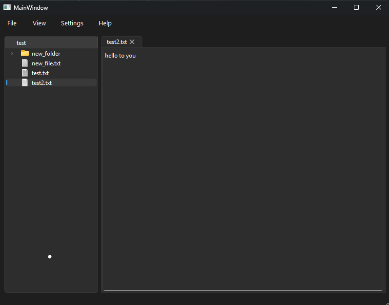

# QuickEdit

QuickEdit est un petit éditeur de texte de bureau construit avec **Qt Widgets**
et **CMake**. Ouvrez un dossier, parcourez son contenu dans une arborescence et
modifiez vos fichiers dans des onglets.

Le projet est open source et accessible aux débutants : que vous soyez ingénieur
confirmé, étudiant, ou que ce soit votre tout premier fork, vous êtes bienvenu
pour ouvrir une issue ou une pull request.



---

## Fonctionnalités

- Ouvrir un dossier et le parcourir dans une arborescence
  (`File > Open Folder`).
- Cliquer sur un fichier pour l'ouvrir dans un onglet ; les fichiers sont lus et
  écrits en texte UTF-8.
- Cliquer sur un fichier déjà ouvert ramène sur son onglet au lieu d'ouvrir un
  doublon.
- Enregistrer le contenu de l'onglet courant sur le disque (`File > Save`).
- Créer un nouveau fichier vide dans le dossier ouvert (`File > New File`).
- Créer un nouveau dossier dans le dossier ouvert (`File > New Folder`).
- Fermer les onglets avec le petit bouton « x ».
- Toutes les chaînes visibles par l'utilisateur passent par `tr()` ; le fichier
  de traduction française (`QuickEdit_fr_FR.ts`) est prêt à être rempli.

## Prérequis

| Outil           | Version / remarque                          |
| --------------- | ------------------------------------------- |
| CMake           | 3.16 ou plus récent                         |
| Compilateur C++ | C++17 (MinGW, MSVC, Clang, GCC, ...)        |
| Qt              | Qt 6 recommandé ; Qt 5 également supporté   |
| Modules Qt      | `Widgets`, `LinguistTools`                  |

## Compiler et lancer

### Avec Qt Creator (recommandé)

1. Installez Qt avec le
   [programme d'installation en ligne de Qt](https://www.qt.io/download-qt-installer)
   et sélectionnez un kit de bureau (par exemple
   **Desktop Qt 6.11.1 MinGW 64-bit**).
2. Dans Qt Creator, ouvrez `CMakeLists.txt` (`File > Open File or Project`).
3. Sélectionnez le kit de bureau et laissez Qt Creator configurer le projet.
4. Appuyez sur **Run** (Ctrl+R).

### Ligne de commande - Windows (MinGW + Qt 6)

Adaptez les chemins à vos versions de Qt et de compilateur.

```powershell
$env:PATH = "C:\Qt\6.11.1\mingw_64\bin;C:\Qt\Tools\mingw1310_64\bin;$env:PATH"
cmake -S . -B build -G "MinGW Makefiles" -DCMAKE_BUILD_TYPE=Debug -DCMAKE_PREFIX_PATH=C:/Qt/6.11.1/mingw_64
cmake --build build
.\build\QuickEdit.exe
```

### Ligne de commande - Linux / macOS

Adaptez `CMAKE_PREFIX_PATH` à votre installation de Qt, ou omettez-le si Qt est
déjà dans le chemin système.

```bash
cmake -S . -B build -DCMAKE_BUILD_TYPE=Debug -DCMAKE_PREFIX_PATH=/chemin/vers/Qt/6.x.x/gcc_64
cmake --build build
./build/QuickEdit
```

## Structure du projet

| Fichier                   | Rôle                                                                     |
| ------------------------- | ------------------------------------------------------------------------ |
| `CMakeLists.txt`          | Construit l'unique cible `QuickEdit` (Qt 6, avec repli Qt 5).            |
| `main.cpp`                | Point d'entrée ; charge `:/i18n/QuickEdit_<locale>` au démarrage.        |
| `mainwindow.h/.cpp`       | Toute la logique de l'application (ouvrir un dossier, ouvrir/enregistrer un fichier, nouveau fichier). |
| `mainwindow.ui`           | Interface Qt Designer : un splitter avec une arborescence et des onglets. |
| `CustomFileSystemModel.h` | Sous-classe `QFileSystemModel` (header-only) qui affiche le nom du dossier ouvert comme en-tête de la première colonne. |
| `QuickEdit_fr_FR.ts`      | Fichier source de la traduction française.                               |

## Comment ça marche

- `mainwindow.ui` définit la mise en page : `Hierarchy` (un `QTreeView`) à
  gauche, `tabs` (un `QTabWidget`) à droite, séparés par `splitter`.
- **Open Folder** demande un dossier avec `QFileDialog`, construit un
  `CustomFileSystemModel` pour ce dossier et ancre l'arborescence dessus.
- Cliquer sur un fichier le lit et crée un `QTextEdit` dans un nouvel onglet. Le
  chemin complet du fichier est stocké dans la propriété `whatsThis()` de
  l'éditeur.
- **Save** prend l'onglet actif, lit le chemin stocké dans `whatsThis()` et
  réécrit le contenu de l'éditeur dans ce fichier.
- **New File** demande un nom et crée un fichier vide dans le dossier
  actuellement ouvert dans l'arborescence.

## Contribuer

Les contributions sont bienvenues, des premiers contributeurs aux développeurs
expérimentés. Forkez
[neylorxt/QuickEdit](https://github.com/neylorxt/QuickEdit) puis suivez ces
étapes :

1. Créez une branche pour votre modification (par exemple
   `git checkout -b fix-tab-close`).
2. Faites votre modification et compilez le projet pour vérifier qu'il se
   construit correctement.
3. Lancez l'application et testez votre changement manuellement - il n'y a
   encore ni tests automatisés, ni CI, ni linter.
4. Committez avec un message clair et ouvrez une pull request décrivant ce que
   vous avez fait.

Règles :

- Entourez toute nouvelle chaîne visible par l'utilisateur de `tr()`.
- Les commentaires sont actuellement un mélange de français et d'anglais ; les
  deux sont acceptés.
- Si vous ajoutez ou modifiez des chaînes visibles, mettez à jour le fichier de
  traduction avec `lupdate` :
  `C:\Qt\6.11.1\mingw_64\bin\lupdate.exe . -ts QuickEdit_fr_FR.ts`
  (sous Linux/macOS : `<installation Qt>/bin/lupdate . -ts QuickEdit_fr_FR.ts`).
- Gardez si possible chaque pull request centrée sur une seule modification.

## Problèmes connus et feuille de route

- `Open File` et `Save As` ne sont pas encore implémentés.
- Aucune confirmation n'est demandée en cas de modifications non enregistrées
  lors de la fermeture d'un onglet.
- Les traductions ne sont pas encore intégrées à l'exécutable ; l'interface
  reste en anglais même lorsqu'une traduction est disponible.
- Aucun test automatisé pour l'instant ; une petite cible de tests pour la
  logique de fichiers serait une bonne première contribution.

## Licence

Aucun fichier `LICENSE` n'a encore été ajouté. En attendant, les règles de
copyright par défaut s'appliquent (tous droits réservés) : contactez le
mainteneur du projet avant de réutiliser ou redistribuer le code.
